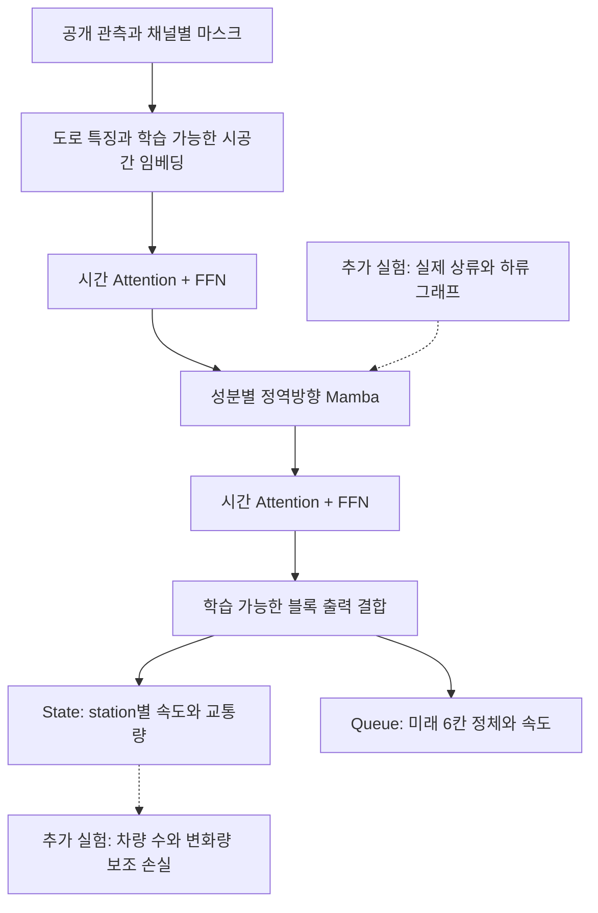

# TrafficFlowBench 모델 구현 점검과 개선 순서

2026-10-05의 실제 학습 성능·기능 제거 검사·전처리 진단은 [PERFORMANCE_DIAGNOSIS.md](PERFORMANCE_DIAGNOSIS.md)에 정리했습니다. 코드의 기능 검사 통과와 점수 기여를 구분합니다.

정리일: **2026-10-03, 한국시간(KST)**. GPU 비교는 2026-10-02에 수행했고 환경·데이터 확인은 10월 3일까지 이어졌습니다. [MODEL_PLAN.md](MODEL_PLAN.md), Windows 소스, WSL 소스·체크포인트, 실제 공개 데이터, 아래 원문 자료를 대조했습니다. 세 소스 파일은 Windows와 WSL에서 줄바꿈을 제외하고 동일했습니다.

## 2026-10-04 구현 반영

이 절은 **v2의 현재 상태**이며, 아래 1~7절은 2026-10-03에 조사한 기존 9채널 모델의 기록입니다. 기존 체크포인트의 재평가 값과 v2의 실행 점검 값을 구분합니다. 변경한 Windows 소스와 WSL 소스를 함께 반영했습니다.

| 점검에서 빠졌던 항목 | 반영한 코드와 상태 |
| --- | --- |
| 실제 Mamba·FFN·임베딩·skip | `src/fast_model.py`에 공식 Mamba-2, 노드·5분 시각·요일·상대 시점 임베딩, FFN·dropout 0.1, 블록 출력 concat+Linear 구현. Mamba-1 원논문 재현과 구분 |
| 공개 입력 누락 | `src/data.py`에 31채널 계약. 교통량·점유율·관측률·채널별 마스크·관측 나이·용량·도로 순서 위치·램프 진입/진출/유효성·fit 구간 평균을 학습과 추론에 연결 |
| 마스크·State 집계 | 배포 masked 입력과 train 템플릿의 정확한 셀 사용. blank buffer를 정답으로 취급하지 않음. 정규화 MSE 학습, RMSE 기반 State로 regime·방향·도로군 선택 |
| 그래프·Physics | `--graph` 상/하류 잔차, `--lambda-n`·`--lambda-dn`·`--lambda-fd` 보조 손실과 진단 구현. 기본 Physics 계수 0, 비교 실험으로 선택 |
| Queue 라벨·손실 | 링크 내 적격 station 중 하나라도 임계값 이하이면 정체. onset·ongoing·정상 창, 기본 6시간 간격, BCE+soft-IoU+미래 속도 손실. soft label·불확실성 가중치 옵션 |
| State→Queue 전이 | `--init-state`로 인코더·노드 ID·fit 통계 이전. 패널·도로 배치·학습 데이터 불일치 차단 |
| GPU·데이터 준비 | 자동 BF16, 패널별 배치, Queue 다일 배치, 제한된 선처리 worker, 고정 메모리·비동기 전송, fused AdamW, 파일·레이아웃·통계 캐시 |
| 학습 재개·재현 | 최대 75 epoch, early stopping·scheduler·gradient clipping, epoch·optimizer·RNG 저장, `.last.pt` 재개. JSONL 진행과 일자별 검증 기록, 공식 Mamba 버전·WSL 설치 목록 고정 |
| 잠금 평가·비교 | `evaluate --period holdout`, Queue 임계값 고정, 같은 표본의 보간·fit 평균·persistence 비교, 일자 bootstrap. 공식 station별 과거 평균과 bit 단위 동등성은 미검증 |
| ODME·앙상블 | 가린 관측 링크로 λ 비교. 희소 incidence와 측정 링크 차원의 dual NNLS, primal/dual gap으로 해 검사. 여러 체크포인트의 State 값·Queue 확률 평균과 키 일치 검사 |

구현 파일: [모델](src/fast_model.py), [데이터](src/data.py), [학습·평가·추론](src/learning.py), [CLI·ODME·앙상블](src/run.py), [계약 검사](tests/test_v2.py), [실행 안내](README.md#11-모델-학습과-검증-사용법).

### 직접 실행한 검증

- **WSL 16개 검사 모두 통과**했습니다. Windows에서는 15개 통과, 공식 Mamba 검사는 설치가 없어 1개 생략했습니다. [WSL 검사 기록](artifacts/v2-tests-wsl.log). 채널별 결측·미래 입력 차단·정확한 template·fit 날짜·물리 단위·그래프 방향·공식 Mamba 성분 분리/BF16 기울기·재개 동등성·추론 키·ODME 기준 해를 검사합니다.
- WSL RTX 5060 Ti에서 **D12_I5_S**의 실제 데이터로 State 1 epoch와 1→2 epoch 재개, State 인코더를 받은 Queue 1 epoch를 실행했습니다. 폭 64·블록 2·graph 활성·BF16이며 State 275,936개, Queue 276,580개 파라미터입니다. 각 기간의 첫 하루만 사용한 실행 검사로, 완료된 전체 학습이 아닙니다. [State 학습](artifacts/v2-state-smoke.log), [재개](artifacts/v2-state-resume.log), [Queue 전이](artifacts/v2-queue-smoke.log)
- 같은 패널의 validation 전체 추론에서 State **219,222행**, Queue **6,000행**의 템플릿 키 정확 일치와 유한값을 확인했고 Queue는 0/1입니다. [검사 결과](artifacts/v2-smoke/inference-check.json)
- 2월 첫 하루의 평가와 일자 bootstrap 명령을 실행했습니다. 하루뿐이므로 bootstrap 구간은 변동성 근거가 되지 않습니다. State 선택·잠금에서도 R1/R2/R3 일부만 있어 누락 regime은 0으로 집계합니다. Queue 대리 지표도 공식 점수와 다릅니다. [State 2월](artifacts/v2-smoke/state-holdout.json), [Queue 2월](artifacts/v2-smoke/queue-holdout.json)
- D12_I5_S ODME에서 관측 링크 20개를 가린 λ 0.01/0.05/0.2 비교를 실행했습니다. 공개 관측에 대한 대리 검증이며 최종 ODME 점수를 뜻하지 않습니다. [결과](artifacts/v2-smoke/odme-proxy.json)

### v2 GPU 실행 점검

공식 Mamba-2·31채널·폭 64·2블록·그래프 잔차·BF16·fused AdamW로 실제 패널 입력을 준비했습니다. 3회 워밍업 후 5회 forward/backward/step을 측정했으며 같은 창을 반복하고 전처리를 제외합니다. 아래는 실행 가능성과 짧은 연산 처리량 기록이며, 기존 9채널 모델 대비 속도 향상이나 전체 epoch 속도 개선을 입증하지 않습니다.

| 패널·과제 | 링크 | 배치 | 단계(ms) | 창/초 | 최고 allocated(GiB) |
| --- | ---: | ---: | ---: | ---: | ---: |
| D12_I5_S / Queue | 100 | 48 | 265.0 | 181.1 | 2.71 |
| D7_I405_N / State | 352 | 2 | 119.3 | 16.8 | 1.19 |
| D7_I405_N / Queue | 352 | 12 | 142.8 | 84.0 | 1.39 |

세 조건의 손실·파라미터 유한값이 통과했습니다. [측정 기록](artifacts/v2-smoke/gpu-check.json). 첫 GPU 호출의 Triton 컴파일은 수십 초 걸렸고 반복 단계 시간에서 제외됩니다. 학습 시작과 첫 batch·데이터 준비·epoch를 별도 로그로 남깁니다.

### 2026-10-04 결측 처리·학습 비중 조정 추가

- `--update-windows 0`으로 State 8개·Queue 48개 창의 기울기를 누적합니다. 메모리에 들어가는 작은 배치는 유지하고, 같은 창 수의 패널에서 업데이트 횟수를 맞춥니다. State 대상 셀 수와 Queue 조건별 창 수로 손실을 정규화하고 마지막 남은 창도 학습합니다. regime별 학습 비중은 아직 별도 조정하지 않았습니다.
- `--missing-aware`는 속도·교통량·점유율별 결측 임베딩을 학습하고 결측 수치를 입력 투영에서 제외합니다. `--graph-mode reliability`는 물리 간선의 이웃 가중치와 집계 게이트를 학습하며 관측 마스크·관측률·결측 경과 시간을 사용합니다. 관측 근거가 없는 이웃의 직접 메시지를 차단합니다. MagiNet에서 참고한 결측 표현과 우리 데이터에 맞춘 집계이며 원논문 전체 재현은 아닙니다.
- 새 옵션은 State 학습·Queue 학습·재개·인코더 전이·평가·제출 추론에서 체크포인트의 모델 설정으로 연결합니다. 기존 v2 모델의 기본 구조와 체크포인트 로드를 유지합니다. 실행 예시는 [README](README.md#학습-시작과-진행-확인)에 있습니다.

합성 입력과 단위 검사 **WSL 22개 모두 통과**, Windows 20개 통과·공식 Mamba 및 Linux 실행 잠금 검사 2개 생략을 확인했습니다. 검사에는 결측 placeholder 차단·관측된 0 구분·관측 품질에 따른 이웃 억제·배치 크기에 따른 업데이트 비중 및 마지막 부분 배치·Queue 조건별 누적 손실/기울기·새 옵션의 재개 및 State→Queue 전이·스크립트 중복 실행 차단이 포함됩니다. WSL 공식 Mamba-2·폭 64·2블록·BF16에서 새 State·Queue의 forward/backward와 기울기 유한값도 확인했습니다. 이는 새 모델의 실제 데이터 재학습이나 점수 개선 검증이 아닙니다.

이 10월 4일 수정에는 Wavelet 경로와 데이터에서 학습한 추가 간선이 포함되지 않았습니다. 해당 기능의 후속 구현은 다음 절에 기록합니다. 기존 그래프 비교 실험과 새 결측 처리 실험은 저장 경로를 구분합니다.

### 2026-10-05 Station 예측층·학습형 그래프·Wavelet 추가

| 항목 | 구현과 적용 범위 |
| --- | --- |
| Station decoder | `--station-decoder gated`: State의 station 문맥을 20채널로 확장하고 MLP·채널별 게이트로 보간 잔차를 학습합니다. 앞뒤 관측값·관측 거리·유효성은 masked 창 내부에서만 만들고 fit 평균을 함께 제공합니다. 기존 `linear`의 구조·가중치 키를 유지합니다. |
| 학습형 추가 관계 | `--adaptive-graph-k`: 노드 임베딩을 source/target으로 투영해 패널 안의 관계 점수를 학습합니다. self edge를 제외한 top-k를 softmax 집계하며 물리 그래프와 별도로 각 블록에 잔차를 추가합니다. 실제 도로 연결이라고 해석하지 않습니다. |
| Wavelet | `--wavelet-levels`: fit 평균으로 채운 마스크 포함 입력 표현에 다단계 Haar DWT를 적용합니다. 추세·각 변동 대역에 독립 depthwise/pointwise temporal convolution을 적용하고 inverse DWT로 복원해 기존 인코더에 더합니다. 홀수 길이는 마지막 값을 복제한 뒤 복원 시 잘라냅니다. |
| Regime 비중 | `--state-regime-balance`: fit 템플릿의 regime별 대상 셀 수와 학습 창 수로 가중치를 계산합니다. 대상 SSE의 창 평균이 패널 내 regime별 MSE 평균이 되도록 정규화하며 기울기 누적에서도 같은 가중치를 유지합니다. 검증은 기존 셀 MSE와 RMSE 기반 State를 유지합니다. |
| 연결·호환 | CLI·학습·optimizer/RNG 재개·State→Queue 인코더 전이·평가·제출 추론까지 설정을 저장·복원합니다. gated State 체크포인트에 station 문맥 계약을 저장하고 불일치를 차단합니다. 새 옵션을 기존 구조의 재개에 켜려는 요청은 안내 오류로 처리합니다. |

기능 검사는 Haar 홀수 길이 복원·변동 대역 유지·기울기, 채널별 station endpoint·관측된 0·창 경계, 학습형 이웃의 희소성·component 사이 전달·순서 복원·기울기, wavelet의 결측 placeholder 차단·모든 대역 학습, Queue 과거 창 밖 관측 변경에 대한 입력/출력 불변성, fit-only regime macro 손실과 누적 기울기 동등성을 포함합니다. 새 구성의 연속/재개 학습·State 제출 추론·Queue 전이·Queue 제출 시각 경계도 검사합니다. 이는 합성 입력의 계약 검사이며 성능 개선 실험과 구분합니다.

**직접 실행한 검증:** WSL 28개 모두 통과했고, Windows 26개 통과·공식 Mamba 및 Linux 실행 잠금 검사 2개 생략을 확인했습니다. [WSL 검사 기록](artifacts/v2-wavelet-tests.log). 실제 공개 `D7_I210_W`의 2030-06-01 입력(링크 81개·물리 간선 15개·연결 성분 66개)으로 공식 Mamba-2·폭 64·2블록·BF16의 새 State·Queue forward/backward를 확인했습니다. 출력과 기울기는 유한했고 모든 wavelet 대역과 학습형 관계의 기울기가 0이 아니었습니다. State의 첫 보정 출력층은 이 실행 검사에서만 작은 무작위 가중치를 넣어 인코더까지 기울기가 전달되는지 확인했습니다. optimizer 업데이트·실제 재학습은 수행하지 않았습니다. [실제 입력 검사](artifacts/v2-wavelet-gpu-check.json)

참고 원문을 2026-10-05에 확인했습니다: [Graph WaveNet](https://arxiv.org/abs/1906.00121), [WavGCRN](https://arxiv.org/abs/2401.06040). 이번 코드는 이 아이디어를 현재 Mamba 인코더에 적용한 것이며 원논문 전체 재현이 아닙니다. Wavelet·학습형 관계는 State와 Queue 인코더에 공통 적용하고, station decoder·regime 손실은 State에만 적용합니다. Queue에는 허용된 과거 12칸만 입력합니다.

전체 데이터 재학습·Kaggle 점수·epoch 처리량 향상은 아직 검증하지 않았습니다. 실행 중인 생산 학습을 시작하거나 중지하지 않았습니다. 별도 저장 경로의 시작 명령은 [README](README.md#station-예측층학습형-그래프wavelet-실험)에 있습니다.

### 2026-10-05 진단 후 세 가지 수정

[진단 당시의 측정](PERFORMANCE_DIAGNOSIS.md)은 수정 전 체크포인트의 기록입니다. 후속 코드에서는 관측 신호 Wavelet·채널별 예측층·전처리 배열화를 반영했습니다. 기존 데이터 계약과 체크포인트 기본 구조를 유지하며 Windows와 WSL 소스를 함께 갱신했습니다.

| 요청 | 코드와 검증 |
| --- | --- |
| Wavelet 적용 위치 | `wavelet_input=signals` 경로는 속도·차로당 교통량·점유율만 fit 평균으로 채워 분해하고 복원 후 투영합니다. 위치 임베딩·관측 여부·결측 토큰은 DWT 밖에 둡니다. `embedded` 경로와 이전 체크포인트 가중치 키는 보존했습니다. |
| 교통량 예측 분리 | `station_decoder=split`은 두 채널의 MLP와 게이트 파라미터를 각각 분리합니다. 공통 인코더·station 문맥은 유지하며 손실 계수는 바꾸지 않았습니다. `gated` 및 `--state-regime-balance` 유무로 공유층·손실 영향의 분리 비교가 가능합니다. |
| station 전처리 | station 루프 대신 배열 누적·gather로 endpoint와 보간을 계산합니다. 인덱스 기준 보간·한쪽 endpoint 연장·전부 결측일 때 fit 평균·실제 시각 기준 거리·관측된 0·채널별 마스크·날짜 경계 복제를 보존합니다. |

**검증 결과:** WSL 31개 모두 통과, Windows 29개 통과·환경 전용 검사 2개 생략입니다. 새 경로의 위치 임베딩 차단·결측 placeholder 차단·대역 기울기·독립 decoder 기울기·전처리 scalar 기준 동등성·연속/재개 동등성·State 제출 추론·Queue 전이 및 미래 입력 차단을 검사했습니다. [WSL 검사 로그](artifacts/signal-split-tests-wsl.log)

공개 `D7_I210_W`와 `D7_I405_N`의 masked 2030-06-01 데이터에서 각 24개 창의 입력·3채널/20채널 문맥을 수정 전 함수와 비교해 정확한 일치를 확인했습니다. 메모리에 둔 같은 입력으로 3회 워밍업 후 11회 교대 측정한 중앙값입니다. 측정 당시 기존 Queue 학습이 실행 중이었으며 전체 학습 처리량과 구분합니다.

| 패널 | station 수 | 문맥 | 수정 전(ms/창) | 수정 후(ms/창) | 비율 |
| --- | ---: | --- | ---: | ---: | ---: |
| D7_I210_W | 81 | 3채널 | 3.17 | 2.90 | 1.09배 |
| D7_I210_W | 81 | 20채널 | 7.60 | 2.85 | 2.67배 |
| D7_I405_N | 352 | 3채널 | 10.15 | 8.00 | 1.27배 |
| D7_I405_N | 352 | 20채널 | 31.53 | 9.32 | 3.38배 |

기존 `artifacts/v2-wavelet/state.pt`·`artifacts/queue-wavelet-only/queue.pt`의 epoch 3 가중치를 수정 전/후 모델에 넣고 실제 입력으로 비교했습니다. 두 모델 모두 CUDA/BF16 출력이 정확히 같았으며 `wavelet_input` 필드가 없는 설정은 이전 `embedded` 경로로 복원됐습니다. 새 `signals`·`split` 구성도 실제 81-node 입력에서 공식 Mamba-2·폭 64·2블록·BF16 forward/backward 및 모든 Wavelet 대역·투영층의 유한하고 0이 아닌 기울기를 확인했습니다. State의 마지막 보정층에는 실행 검사에서만 작은 무작위 가중치를 넣어 인코더 기울기를 검사했습니다. optimizer 업데이트나 새 구조의 실제 재학습은 실행하지 않았습니다. [실제 입력·측정 결과](artifacts/signal-split-check/results.json), [재현 스크립트](artifacts/signal-split-check/verify.py)

WSL 이전 소스는 `artifacts/source-backup-20261004T233208Z-signal-split`에 보관했습니다. 실행 중인 Queue 프로세스는 중단·재시작하지 않았으며, 새로운 구조는 별도 저장 폴더의 새 학습부터 적용합니다. 정확도·전체 epoch 시간·GPU 사용률 향상은 미검증입니다. [새 실행 방법과 비교 조건](README.md#진단-후-수정-관측-신호-wavelet채널별-예측층)

### 남은 검증과 데이터 제약

전체 기간 재학습, 동일 표본의 Mamba-1/2·graph·Physics 계수·전이 효과 비교, 여러 seed, 전체 2월 잠금 평가와 Kaggle 제출은 아직 수행하지 않았습니다. Mamba-1 CUDA 확장과 `torch.compile`의 효과도 미검증입니다. GRIN·STAEformer·PatchTST·Mamba-3 전체 모델은 연구 비교 후보로 남깁니다.

도로 위치는 공개 `order_index`를 정규화해 사용합니다. 자료에 없는 milepost나 외부 연결 링크의 속성·간선은 만들지 않습니다. 램프 품질이 부족하면 값과 유효성 채널로 구분합니다. Physics 항은 공식 Physics 점수가 아니라 train 정답의 N·dN·FD에 대한 보조 학습입니다. 대회 공개 자료만으로 Queue·Physics의 최종 점수는 확인할 수 없습니다. [공식 데이터·로컬 평가 한계](https://github.com/jacky850/trafficflowbench-public/blob/main/docs/DATA.md#what-you-can-and-cannot-score-yourself)

**아래는 2026-10-03 점검 당시의 기록입니다.** 당시 학습된 모델은 자체 공간 스캔을 사용했고, 다음 미구현 표와 GPU 비교는 그 모델을 대상으로 합니다.

## 1. 실제로 학습된 구성과 확인 가능한 결과

| 항목 | 확인 결과 |
| --- | --- |
| 공통 인코더 | 9개 입력 특징 → Linear(64) → 시간 Attention·자체 공간 스캔·시간 Attention 블록 2개 → 블록 출력 평균 |
| 공간 처리 | 연결 성분별 정·역방향 스캔. `mamba_ssm`을 사용하지 않음 |
| State | station별 보간값에 신경망 보정량을 더해 속도·차로당 교통량 복원. 파라미터 135,944개 |
| Queue | 허용된 과거 12칸을 받아 미래 6칸의 정체 확률·속도 출력. 파라미터 136,588개 |
| 학습 기간 설정 | 2030년 6~12월 학습, 2031년 1월 모델 선택 |
| 모델 공유 범위 | 같은 과제의 패널 사이에서는 가중치 공유. State와 Queue는 별도 가중치이며 전이 학습 없음 |
| ODME | 학습하는 신경망이 아니라 `λ=0.05` 정규화 NNLS |

근거: [모델 코드](src/fast_model.py), [학습 코드](src/run.py), [환경·데이터 점검 결과](artifacts/audit_20261002/inspection.json).

저장된 `state.pt`, `queue.pt`를 2031년 1월 전체 선택 구간에 다시 적용한 기록은 다음과 같습니다.

| 과제 | 직접 측정한 로컬 값 | 표본 |
| --- | --- | --- |
| State | 정규화 가중 MSE **0.009547** | 10개 패널, 7,440개 창 |
| Queue | 대리 IoU **0.4548** = onset **0.1144**, ongoing **0.7952**의 평균 | 8개 패널, 2,724개 창, 임계값 0.4 |

[체크포인트 재평가 기록](artifacts/checkpoint-eval.log)에 근거한 값입니다. **공식 State·Queue 점수가 아닙니다.** Queue의 공개 참고 baseline 0.3017은 주최 측 validation 평가값이므로 이 0.4548과 직접 비교할 수 없습니다. [공식 baseline 참고값](https://github.com/jacky850/trafficflowbench-public/blob/c88cddf533bbf0afa4ff1fc6c031d760a08e7a31/docs/BASELINES.md#what-the-reference-baselines-score)

체크포인트에는 epoch·학습 인자·선택 지표·optimizer 상태가 없습니다. 따라서 사용자가 완료한 실행의 저장 가중치는 확인했지만, 실제 완료 epoch와 학습 곡선을 파일만으로 복원할 수는 없습니다. 기본 설정이 3 epoch인 것과 해당 실행이 3 epoch를 끝냈다는 것은 구분해야 합니다.

## 2. 계획 대비 구현 여부

`구현`은 코드가 존재한다는 뜻이며 대회 성능 검증 완료를 뜻하지 않습니다. `미구현`에는 원래 구성에서 누락된 항목과 계획서가 후속 실험으로 명시한 항목을 구분했습니다.

| 계획 항목 | 상태 | 현재 구현과 남은 작업 |
| --- | --- | --- |
| 시간 Attention → 공간 Mamba → 시간 Attention | **핵심 일부 누락** | 순서는 구현했지만 공간은 자체 `SpatialScan`. 실제 Mamba 모듈로 교체 필요 |
| 입력 임베딩·시간/도로 위치 표현 | **부분 구현** | 9채널 Linear, 고정 시각 sin/cos·요일 값만 사용. 학습 가능한 시각·요일·노드/도로 위치·상대 시점 임베딩 없음 |
| FFN·dropout | **미구현** | 현재 Attention 뒤에 FFN 없음. 계획의 dropout 0.1과 달리 Attention 기본 dropout 0 사용 |
| 블록별 skip 출력 결합 | **단순화** | 각 블록 출력을 단순 평균. 논문의 학습 가능한 계층적 출력층과 다름 |
| 연결 성분·정역방향 공간 처리 | **구현** | 성분별 스캔 상태·인접 convolution 경계 분리. 분기·합류의 실제 이웃 전달은 구현하지 않음 |
| `A_up H W_up + A_down H W_down` | **후속 실험 미구현** | topology를 정렬에만 사용. 상·하류 그래프 잔차 없음 |
| 비관측 연결 링크 | **부분 구현** | topology의 행에 있는 링크는 유지. 외부 참조만 있는 링크의 연결·속성은 별도 확인 필요 |
| station별 출력 보존 | **구현** | 마스킹 후 보간·집계, 링크 잠재값 + station별 문맥으로 출력 |
| 점유율·관측 품질·채널별 마스크 | **미구현** | 점유율·`pct_observed`·마지막 관측 이후 시간 없음. 속도·교통량에 하나의 공동 유효 마스크 사용 |
| 용량·도로 위치·램프 특징 | **미구현** | 길이·차로 수·자유류 속도만 사용. 램프 연결·진입/진출량·용량·milepost 없음 |
| train에서 계산한 요일·시간대 평균 | **미구현** | 과거 평균 baseline 호출 경로는 있지만 모델 입력의 기준값은 없음 |
| Task 1 72칸 입력/가운데 12칸 복원 | **구현** | 날짜 경계 복제, station 출력, 단위 환산, 비음수 출력 구현 |
| Task 1 R1/R2/R3 마스킹 | **부분 구현** | 20/30/50% 확률 마스크, 링크 내 station 동시 가림. 공식 hash·Task 2 history 제외·horizon/buffer 처리 미재현 |
| Task 1 손실과 모델 선택 | **부분 구현** | 0.54/0.46 정규화 MSE 구현. 공식 RMSE 기반 State·regime별 값으로 선택하지 않음 |
| Task 2 입력 시각·출력층 | **구현** | 과거 `[T-60분,T)`, 미래 `T+5~T+30분`. 정체·미래 속도 출력층 있음 |
| Task 2 공개 입력 활용 | **중요 누락** | 속도·유효성만 읽음. 학습·추론에서 교통량 채널을 0으로 넣고 공개 점유율·관측률도 무시 |
| Task 2 표본·손실 | **부분 구현** | onset/ongoing 샘플 + BCE + 0.1×속도 Smooth L1. 정상 유지 창 진단, soft-IoU, 경계 라벨 가중치/soft label 없음 |
| Task 2 임계값·검증 집계 | **부분 구현** | 0.3/0.4/0.5/0.6 중 하나 선택, onset/ongoing 평균 있음. 패널·도로군 균등 집계와 공식 창 선택 간격 미재현 |
| State → Queue 전이 | **후속 실험 미구현** | Queue는 별도 무작위 초기화 |
| Task 3 차량 수·차분·FD 보조 손실 | **후속 실험 미구현** | Task 1 예측을 제출에 재사용하는 것만 가능. Physics 학습·진단 없음 |
| Task 4 NNLS·λ 비교 | **부분 구현** | split별 prior·관측 링크·전체 경로 출력 구현. λ 탐색·가린 링크 검증 없음 |
| 날짜 분할·잠금 평가 | **부분 구현** | 학습 7개월/선택 1개월 사용. 2031년 2월 잠금 평가 명령·보고 없음 |
| 패널 균형 학습 | **부분 구현** | 패널 순서를 섞지만 패널 하나의 모든 날짜를 연속 처리. 균형 있게 교차 추출하는 sampler 없음 |
| 공식 baseline과 동일 표본 비교 | **검증 미완료** | 과거 평균·보간·persistence와 같은 마스크·같은 창에서 비교한 보고 없음 |
| 학습 관리·재현 | **부분 구현** | seed·최선 가중치 저장·진행 출력 있음. epoch/optimizer 복원, 이력 파일, early stopping, scheduler, 의존성 버전 고정 없음 |
| 제출·필수 검사 | **부분 구현** | 과제별 추론·외부 공식 병합·누락 경고 차단 코드 있음. 전체 제출 생성·공식 점수 재현은 확인하지 못함 |
| 여러 seed·앙상블·일자별 변동 | **후속 실험 미실행** | 비교 결과와 변동성 보고 없음 |

구현 근거는 `src/fast_model.py`의 `SpatialScan`·`FASTBlock`·`FASTEncoder`, `src/data.py`의 `StationDay.load`·`link_features`, `src/run.py`의 `day_masks`·`fit_state`·`queue_windows`·`fit_queue`·`predict_queue`입니다. 원 FAST의 임베딩·FFN·공간 Mamba·출력층은 [논문 III절](https://arxiv.org/html/2604.13453v1), 대회 마스크와 집계는 [MASK_SPEC](https://github.com/jacky850/trafficflowbench-public/blob/main/docs/MASK_SPEC.md)·[SCORING_SPEC](https://github.com/jacky850/trafficflowbench-public/blob/main/docs/SCORING_SPEC.md)과 대조했습니다.

### 데이터에서 추가로 확인한 두 가지

**Task 2의 교통량은 실제로 사용할 수 있는 입력입니다.** `task2/D7_I405_N/validation/window_history.parquet`의 42,240행에서 `flow_vph`·`occupancy`의 비결측 비율은 각각 약 83.1%, `pct_observed`는 100%입니다. 따라서 속도만 사용하는 제한은 데이터에 따른 제약이 아니라 현재 전처리의 누락입니다. 모든 입력은 공개 history 안에서 읽고, 학습 창에도 같은 특징·결측 규칙을 적용해야 합니다. 채널별 단위·집계·마스크를 맞춘 뒤 다시 학습해야 합니다.

**공간 연결 단절을 코드 오류 하나로 단정할 수는 없습니다.** 현재 레이아웃에서 `D7_I405_S`는 109노드/94성분/최장 3노드, `D12_I5_S`는 100노드/70성분/최장 4노드입니다. 반면 `D7_I405_N`은 352노드/20성분/최장 332노드입니다. `D7_I405_S` topology가 참조하는 외부 링크 200개는 topology 행에도 `links.csv`에도 없습니다. 추가 공식 연결 정보와 도로 위치를 확인해야 하며, ID가 가까운 노드를 임의로 이어서는 안 됩니다. Mamba도 입력에 없는 연결 관계를 자동으로 복원해 주지는 않습니다. [직접 조사 결과](artifacts/audit_20261002/inspection.json)

## 3. GPU 처리량을 더 높일 수 있는가

**가능합니다. 이번 측정에서는 작은 패널의 배치 확대가 가장 컸고, 큰 패널에서는 BF16이 유리했습니다.** GPU 사용률 90~100% 달성을 측정하거나 보장한 것은 아닙니다. 완료한 창 수/초와 검증 품질을 기준으로 판단해야 합니다.

### 측정 조건과 결과

- WSL Ubuntu 22.04, RTX 5060 Ti 16GB, Python 3.10.12, PyTorch `2.13.0+cu130`.
- 다른 학습이 없는 상태에서 실제 하루의 창을 준비하고 GPU에 미리 올렸습니다. 기본 모델 64차원·2블록, 정역방향, AdamW의 forward/backward/step을 측정했습니다.
- 3단계 워밍업 후 10단계씩 3회 반복한 중앙값입니다. CPU 연산 스레드는 1개, FP32 matmul precision은 `highest`입니다.
- 데이터 읽기·전처리·CPU→GPU 전송을 단계 시간에서 제외했습니다. 큰 배치는 준비한 창을 반복해 채운 연산 실험으로, 학습 품질 비교나 전체 epoch 속도 측정이 아닙니다.
- 메모리는 PyTorch의 최고 allocated 값이며 `nvidia-smi`의 전체 사용량과 다릅니다. 18개 eager 조건 모두 손실·파라미터 유한값 검사를 통과했습니다.

| 과제·패널 | 링크 | 정밀도 | 배치 | 단계 시간(ms) | 창/초 | 최고 메모리(GiB) |
| --- | ---: | --- | ---: | ---: | ---: | ---: |
| State / D12_I405_S | 44 | FP32 | 2 | 37.0 | 54.0 | 0.29 |
| State / D12_I405_S | 44 | FP32 | 8 | 45.6 | **175.6** | 0.98 |
| State / D12_I405_S | 44 | BF16 | 8 | 53.0 | 151.0 | 0.80 |
| State / D7_I405_N | 352 | FP32 | 2 | 113.9 | 17.6 | 2.20 |
| State / D7_I405_N | 352 | BF16 | 2 | 93.6 | **21.4** | 1.82 |
| State / D7_I405_N | 352 | BF16 | 8 | 410.9 | 19.5 | 7.15 |
| Queue / D12_I5_S | 100 | FP32 | 12 | 64.6 | 185.9 | 0.66 |
| Queue / D12_I5_S | 100 | BF16 | 12 | 55.7 | 215.3 | 0.59 |
| Queue / D12_I5_S | 100 | BF16 | 48 | 109.1 | **439.9** | 2.10 |
| Queue / D7_I405_N | 352 | FP32 | 12 | 121.1 | 99.1 | 2.38 |
| Queue / D7_I405_N | 352 | BF16 | 12 | 105.0 | **114.3** | 2.04 |
| Queue / D7_I405_N | 352 | BF16 | 48 | 481.1 | 99.8 | 8.03 |

근거: [18개 조건의 원시 결과](artifacts/audit_20261002/gpu-eager.json), [측정 스크립트](artifacts/audit_20261002/profile_gpu.py). 작은 패널에서는 일부 반복 편차가 있었으므로 이 배율을 전체 학습 시간에 그대로 적용하지 않습니다.

해석은 다음과 같습니다.

1. State 44링크에서는 FP32 배치 2→8로 **처리량 약 3.25배**였습니다. 배치를 CLI 인자로 노출하고 패널별로 고를 가치가 있습니다.
2. State 352링크에서는 같은 배치 2의 BF16이 **약 1.22배**, Queue 352링크에서는 같은 배치 12의 BF16이 **약 1.15배**였습니다. 두 경우 모두 더 큰 배치는 처리량이 떨어졌습니다.
3. Queue 100링크에서는 BF16 배치 12→48로 **약 2.04배**였고, FP32 배치 12와 비교하면 **약 2.37배**였습니다. 현재 하루 단위 묶음을 여러 날짜의 창으로 모으는 변경이 필요합니다.
4. 현재 `--bf16`은 이미 사용 가능합니다. 패널별 배치 설정·Queue 다일 배치는 아직 구현되지 않았습니다. 배치를 바꾸면 optimizer 갱신 횟수도 달라지므로 같은 학습 표본·검증 기준에서 품질을 다시 확인해야 합니다.

### 병목 근거와 최적화 순서

352링크 State FP32 배치 2의 5단계 프로파일에서 모델 전체의 self CUDA 시간 중 `mul` 22.7%, `copy_` 13.4%, `cat` 7.4%가 확인됐습니다. 현재 공간 스캔은 노드 수에 따라 반복하는 누적 계산과 텐서 복사를 많이 사용하므로 주요 개선 후보입니다. 이 비율 전부를 공간 스캔 하나의 시간으로 분리 측정한 것은 아닙니다. Attention은 이미 `need_weights=False`와 PyTorch의 효율적인 Attention 커널을 사용하고 있습니다. [프로파일 표](artifacts/audit_20261002/state-fp32-profiler.txt)

| 우선순위 | 조치 | 현재 근거·한계 |
| --- | --- | --- |
| 높음 | 작은 패널 배치 확대, 큰 패널 BF16 | 위 연산 실험에서 개선 확인. 패널별 최적 배치는 추가 측정 필요 |
| 높음 | 실제 Mamba 커널과 현재 scan 비교 | 원 계획 복원과 연산 통합을 함께 검토. 아직 설치·속도·정확도 미검증 |
| 높음 | 날짜 파일 목록·레이아웃 캐시, 다음 1~2일 선처리 | 매번 Parquet 날짜 열 조사, 매 forward 경계/역순 텐서 생성, 순차 데이터 준비를 줄일 수 있음 |
| 중간 | 소수 worker·고정 메모리·비동기 전송 | 읽기·전처리를 GPU 연산과 겹치는 후보. 실제 효과는 전체 루프에서 측정 필요 |
| 중간 | `torch.compile`/CUDA Graphs | 시험했으나 현재 환경의 `Python.h` 누락으로 실패. 속도 개선값 없음 |
| 낮음 | fused AdamW·로그 동기화 축소 | fused AdamW는 큰 State BF16에서 약 3% 차이, 손실 scalar 동기화 제거는 거의 차이 없음. 주 병목 해결책으로 보기 어려움 |

캐시된 파일에서도 352링크 하루의 읽기+특징 생성은 State 약 248ms, Queue 약 85ms였습니다. Queue는 하루당 학습 단계가 한 번이라 CPU 준비가 차지하는 비중도 무시하기 어렵습니다. 현재 WSL 메모리는 약 7.6GiB이므로 전체 데이터를 무제한 RAM 캐시하는 대신 작은 선행 준비 큐부터 시작하는 편이 적절합니다. 이 전처리 수치는 파일 선택·모든 epoch 비용을 포함하지 않습니다.

연산 통합, AMP, 데이터 선행 준비의 일반적 근거는 [PyTorch 성능 가이드](https://docs.pytorch.org/tutorials/recipes/recipes/tuning_guide.html)입니다. 현재 코드에서는 먼저 단계별 시간과 epoch 시간을 함께 남겨 실제로 줄었는지 확인해야 합니다.

## 4. Mamba를 어떻게 반영할 것인가

### 현재 환경에서 필요한 준비

`mamba_ssm`, `causal_conv1d`, `einops`, `ninja`는 설치되지 않았고 `nvcc`도 없습니다. Triton은 설치돼 있지만 `/usr/include/python3.10/Python.h`가 없어 이번 `torch.compile` 시험이 실패했습니다. **PyTorch CUDA 실행 성공과 외부 CUDA/Triton 모듈 빌드 준비 완료는 별개입니다.** [환경과 실패 요약](artifacts/audit_20261002/inspection.json)

Python 버전에 맞는 개발 헤더를 먼저 준비하고, 실제 사용할 Mamba 버전·Torch/CUDA·GPU 아키텍처 조합을 고정해야 합니다. 2026-10-03 확인한 공식 저장소는 기본 설치가 `selective_scan_cuda`를 포함하지 않는다고 설명합니다. Mamba-1의 CUDA scan이 필요하면 해당 설치 모드를 명시하고, 호환 wheel이 없으면 로컬 빌드 도구를 준비해야 합니다. 단순 import 성공을 설치 검증으로 삼지 말고 실제 입력 크기의 forward/backward를 통과시켜야 합니다. [공식 설치 안내](https://github.com/state-spaces/mamba#installation)

Mamba-2 소스에는 비융합 경로의 PyTorch convolution 대체 구현이 있지만 Triton scan은 여전히 필요합니다. 또한 packed sequence의 convolution은 별도 조건이 있습니다. 따라서 “Mamba-2라서 빌드 환경 없이 된다”는 가정은 하지 않습니다. [Mamba-2 구현](https://github.com/state-spaces/mamba/blob/main/mamba_ssm/modules/mamba2.py)

### 현재 코드에 넣는 위치

1. `src/fast_model.py`의 `SpatialScan` 자리에 공식 `Mamba` 공간 블록을 넣습니다. 시간 Attention 앞뒤 순서와 station별 출력 경로는 유지합니다. 첫 비교 설정은 64차원, `d_state=64`, `d_conv=2`, `expand=1`로 잡을 수 있습니다. 이는 FAST 논문의 설정을 참고한 출발점이며 현재 과제 최적값은 아닙니다. [FAST 실험 설정](https://arxiv.org/html/2604.13453v1)
2. `[B,T,N,D]`에서 공간 축을 scan하도록 `[B*T,N,D]`로 바꿉니다. 실제로는 연결 성분별 독립 sequence로 묶고 길이가 비슷한 성분을 함께 배치합니다. 성분마다 Python으로 모듈을 94번 호출하는 방식은 피합니다.
3. 정·역방향 공간 Mamba를 각각 적용하고 역방향 결과를 원래 노드 순서로 복원합니다. 역순은 유효 길이 안에서 만들고 패딩은 그 뒤에 붙입니다. 서로 다른 성분 사이에서 **SSM 상태와 convolution 상태 모두** 섞이지 않는 검사가 필요합니다.
4. FFN·dropout·학습 가능한 임베딩·skip 출력층을 복원합니다. 모델 복원 항목과 추가 그래프 실험은 이름과 결과를 구분해 저장합니다.
5. 같은 인터페이스에 `Mamba2`를 넣은 구성도 비교합니다. Mamba-2는 행렬 연산을 활용하는 SSD 기반 후보이지만, 이것은 원 FAST와 구분되는 변경입니다. 짧거나 많이 끊긴 공간 sequence에서 더 빠르거나 정확하다는 보장은 없습니다. [Mamba-2 논문](https://arxiv.org/abs/2405.21060)

기존 자체 스캔 가중치는 공식 Mamba 가중치로 그대로 변환할 수 없습니다. 기존 체크포인트는 비교용으로 보존하고 새 모델을 다시 학습해야 합니다. 이번 점검에서는 Mamba 설치나 새 전체 학습을 수행하지 않았습니다.

## 5. 함께 검토할 유용한 기술

아래 우선순위와 적용 방법은 **이 프로젝트를 위한 제안**입니다. 해당 논문의 다른 교통 데이터 결과가 TrafficFlowBench 점수를 보장하지는 않습니다. 모든 모델을 한 번에 합치지 않고 같은 선택 구간에서 한 변경씩 비교합니다.

| 기술·우선순위 | 유용한 이유 | 여기서 반영할 방법 | 주의점·원문 |
| --- | --- | --- | --- |
| **Mamba / Mamba-2 — 높음** | 선택적 상태 전달, 효율적인 공간 sequence 연산 후보 | 위 절처럼 자체 scan을 교체하고 정역방향·성분 경계를 보존 | Mamba-2는 별도 변형. 정확도·속도 실측 필요. [공식 구현](https://github.com/state-spaces/mamba) |
| **STID식 시간·노드 identity — 높음** | 현재 부족한 도로별 특성과 출퇴근 시간대 표현을 보완 | `FASTEncoder`에 시각 288칸·요일 7개·패널/링크 또는 도로 위치 임베딩, 입력 상대 시점 추가. ID 매핑을 체크포인트에 저장 | STID 전체를 이식하지 않고 임베딩 원리를 적용 가능. 보지 못한 노드는 정적 특징으로 처리. [STID](https://github.com/GestaltCogTeam/STID) |
| **Graph WaveNet식 방향별 그래프 + TCN — 높음/중간** | 실제 상·하류 및 분기 관계, 짧은 시간 문맥을 다루는 비교안 | 먼저 공간 블록 옆에 작은 `A_up/A_down` 잔차 추가. 별도 비교 모델에서 시간 Attention을 dilated Conv1d로 교체 | 데이터로 확인한 간선부터 사용. 학습 인접행렬은 도로군 경계를 지키는 후속 실험. [Graph WaveNet](https://github.com/nnzhan/Graph-WaveNet) |
| **GRIN식 마스크 인지 그래프 복원 — 중간** | Task 1의 핵심은 결측 복원이므로 과제 적합성이 높음 | 채널별 마스크·관측 경과 시간·양방향 문맥을 넣고, 복원 head 비교 또는 독립 baseline으로 사용 | Task 1의 미래 문맥을 Task 2 입력에 섞지 않음. 순환 구조의 속도는 별도 확인. [GRIN](https://github.com/Graph-Machine-Learning-Group/grin) |
| **STAEformer — 중간** | 적응형 시공간 임베딩을 갖춘 Transformer 비교 기준 | 같은 입력·마스크·출력층을 사용하고 FAST encoder만 교체하는 비교 모델 | 위치 표현을 추가한 효과와 공간 연산 변경 효과를 분리. 공간 Attention 비용 확인. [STAEformer](https://github.com/xdzhelheim/staeformer) |
| **PatchTST식 시간 patch·마스크 사전학습 — 낮음/중간** | 긴 입력을 압축하거나 추가 자기지도 학습에 활용 가능 | Task 1의 72칸을 6/12칸 patch로 묶고 5분 단위 출력 decoder·마스크 유지. 허용된 train 구간에서만 사전학습 | Task 2는 과거가 12칸이라 우선 이득이 불확실. 짧은 정체 변화를 잃을 수 있음. [PatchTST](https://github.com/yuqinie98/PatchTST) |
| **Mamba-3 — 후순위 비교** | 더 풍부한 상태 갱신과 MIMO를 제안하는 최신 SSM 계열 | Mamba-1/2와 검증 경로를 안정화한 뒤 같은 공간 adapter에서 독립 비교 | 공개된 주요 실험은 언어·상태 추적이며 이 대회 적용 근거는 미확인. MIMO에는 추가 커널 의존성이 있음. [논문](https://arxiv.org/abs/2603.15569), [구현](https://github.com/state-spaces/mamba/blob/main/mamba_ssm/modules/mamba3.py) |

모델 이름과 별개로, **Queue onset 학습과 검증 정비**를 높은 우선순위로 둡니다. 현재 0.1144/0.7952의 차이는 정체 발생과 지속을 따로 볼 필요가 있다는 증거입니다. 먼저 동일 창의 persistence와 비교하고, 공개 교통량·점유율과 과거 구간 안의 변화량을 추가한 뒤 onset/ongoing 손실 균형·soft-IoU를 하나씩 비교합니다. 정상 유지 창은 별도 진단을 남기며, 임계값 근처 soft label은 추가 실험으로 분리합니다. 이 변화가 점수를 올린다는 것은 아직 가설입니다.

Physics는 `N`·`ΔN` 보조 손실부터 비교하고, 램프·유효 링크·단위 처리가 확인된 뒤 FD 항을 검토합니다. 밀도를 `q/v`로 정의한 뒤 `q=k*v`만 맞추는 손실에는 독립적인 학습 정보가 없습니다. 공개 데이터의 대리 Physics와 주최 측 비공개 평가량도 구별합니다. [계획서의 Physics 정의](MODEL_PLAN.md#4-task-3-차량-수의-시간-변화까지-복원합니다)

## 6. 반영 순서와 통과 조건

다음은 새 구현의 제안 구조입니다. 아직 구현된 구조를 표시한 그림이 아닙니다.



그림의 블록 구현은 공유하되 State·Queue 가중치와 학습은 분리합니다. 전이 학습은 별도 실험입니다.

| 순서 | 작업 | 통과 조건 |
| --- | --- | --- |
| 1 | 고정 마스크·창·공식 방식 집계, baseline 비교, 로그·체크포인트 정보 저장 | 동일 표본에서 보간/과거 평균/persistence와 재현 가능한 비교. 2월은 최종 평가까지 잠금 |
| 2 | 공개 입력 누락 복원과 전처리 통일 | train/predict의 채널·단위·시간 경계·결측 규칙 일치. 숨긴 답이 집계·보간·평균 특징에 들어가지 않음 |
| 3 | 작은 패널 배치 설정·제한된 선행 준비, 큰 패널 BF16 비교 | 같은 표본의 처리량과 epoch 시간 개선, 선택 지표 악화 여부 기록 |
| 4 | 빌드 환경 준비, 실제 Mamba·FFN·임베딩·skip 출력층 구현 | 큰/작은/분절 패널 forward/backward, 독립 성분 간 무간섭, station 순서 복원, 작은 배치 적합 검사 |
| 5 | Mamba-1/2·그래프 잔차·Queue 손실/전이 비교 | 한 변경씩 같은 날짜·표본·학습 예산에서 품질/시간/메모리 기록. onset과 ongoing 각각 비교 |
| 6 | 램프·Physics 보조 손실, ODME λ 소규모 비교 | State와 대리 Physics의 균형, 가린 관측 링크 오차·prior 이동량 확인 |
| 7 | 상위 구성의 seed 재실행, 잠금 평가, 전체 제출 검사 | 개선 재현, 패널/regime 악화 확인, validation/private 키 누락·중복 없음 |

복원이 필요한 원래 기능과 추가 연구 후보는 함께 추적하되, 모든 비교를 처음부터 하나의 대형 모델에 넣지는 않습니다. GPU 사용률을 높이기 위해 의미 없이 모델 크기부터 키우는 것보다 현재 입력 누락과 검증 차이를 먼저 바로잡는 편이 판단 가능한 결과를 만듭니다.

## 7. 2026-10-03 점검의 산출물과 재실행

- [구현 계획](MODEL_PLAN.md), [실행 안내](README.md)에서 오래된 학습 상태 설명을 수정했습니다.
- 학습용 `src/`와 기존 체크포인트는 이번 점검에서 변경하지 않았습니다.
- 연산 측정·환경 결과는 Git 제외 경로인 `artifacts/audit_20261002/`에 저장했습니다. 컴파일은 실패 상태로 기록했습니다.
- 2026-10-03 WSL에서 기존 단위 검사 7개가 통과했습니다. 문서 제목·코드 블록·로컬 링크/앵커·행 끝 공백과 `git diff --check`도 확인했습니다. 이 검사는 예측 성능이나 공식 제출 완성을 증명하지 않습니다.
- 공식 Mamba 실행, 새 모델의 전체 학습, Kaggle 제출, 전체 epoch 속도와 공식 점수 검증은 수행하지 않았습니다.

이번 eager 연산 비교를 다시 실행하는 WSL 명령입니다. 체크포인트를 저장하거나 덮어쓰지 않지만 측정용 GPU 연산을 수행하므로 다른 학습이 끝난 뒤 실행합니다.

```bash
cd /home/parkj/projects/trafficflowbench
.venv/bin/python -u /mnt/c/Users/parkj/project/trafficflowbench/artifacts/audit_20261002/profile_gpu.py \
  --release-root /home/parkj/projects/trafficflowbench/data/kaggle_public \
  --output /mnt/c/Users/parkj/project/trafficflowbench/artifacts/audit_20261002/gpu-eager.json
```

## 2026-10-25: Task 2 입력·표본·출력층

Queue 전용으로 공개 masked `T` 입력, epoch별 학습 창 재추출, 조건별 창 간격, 마지막·시간 평균 표현의 MLP 출력층, 5·15분 변화량을 선택 옵션으로 추가했습니다. 기본 31특징·12시점과 기존 체크포인트는 유지하며, 새 옵션은 각각 별도 경로에서 학습합니다. 검증에는 날짜를 분산한 고정 창과 `window_signature`를 추가했습니다. [실행 방법](README.md#task-2-입력표본출력층-비교)

2026-10-25 확인한 [공식 Task 2 명세](https://github.com/jacky850/trafficflowbench-public/blob/main/docs/SCORING_SPEC.md#task-2-queue-forecasting)는 공개된 `T` 행 사용을 허용하고, 대상에서 `D12_I405_N/S`를 제외합니다. `T` 입력은 train에서도 공개 masked 파일에서만 읽으며, 해당 학습 원본이 바뀌면 재개를 차단합니다.

- WSL 전체 회귀 검사 **60개 모두 통과**했습니다. 새 검사 7개에는 미래 관측·원래 정답의 입력 유입 차단, 결측·변화량 마스크, epoch별 재추출과 고정 검증, 날짜 분산, 기존 체크포인트 출력 일치, 학습 재개 및 State→Queue 전이, 추론 키·시간 경계를 포함했습니다. [검사 로그](reports/task2-tests-wsl.log)
- RTX 5060 Ti에서 `D12_I5_S`의 fit·select 각각 첫 이틀로 기본형 1 epoch, 새 옵션 조합의 연속 2 epoch 및 1→2 epoch 재개를 BF16으로 실행했습니다. 두 후보의 검증 창은 동일한 6개였으며, 연속·재개 학습의 최대 가중치 차이는 `2.33e-10`이었습니다. 이는 실행·재현 검사입니다.
- 새 조합의 입력은 `[10, 13, 100, 44]`였고, validation·private 각각 6,000행의 템플릿 키·순서·중복·0/1 값을 검사했습니다. 두 split에서 `T` 속도가 관측된 링크 비율은 합계 약 64.75%였습니다. 없는 `T` 속도는 결측으로 유지했습니다. [실제 데이터 검사](reports/task2-gpu-check.json)
- Windows·WSL 소스에 반영했고, WSL의 별도 `MODEL_PLAN.md` 변경은 보존했습니다. 기존 `v2/queue.pt`, `queue-wavelet-only/queue.pt`, `v2/state.pt`의 SHA-256은 그대로입니다. 이전 소스는 WSL의 `artifacts/source-backup-20261025-task2-wno0orgf/`에 보관했습니다. [반영 기록](reports/task2-wsl-sync.json)

전체 8개 패널의 재학습 성능·공식 Queue 점수·최종 병합 제출은 검증하지 않았습니다. 단독 옵션 비교에서 효과를 확인한 뒤 조합해 주세요. 현재 1월은 모델·임계값 선택에 함께 사용하며, 2월에는 저장된 임계값을 고정합니다.
